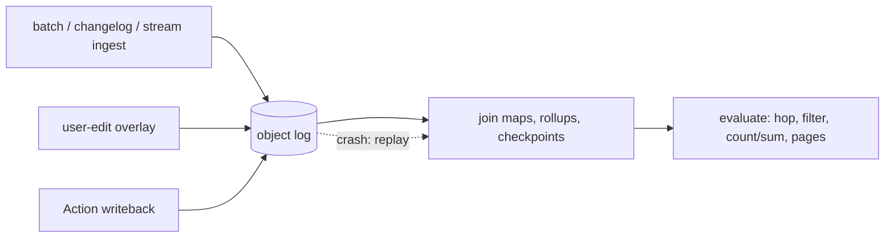

# mikura

**An object database: the log is the truth, everything else rebuilds.**

[](https://github.com/Sannrox/mikura/actions/workflows/ci.yml)
[](https://github.com/Sannrox/mikura/releases)
[](LICENSE-MIT)

[Quickstart](#try-it-in-five-minutes) · [Docs](docs/README.md) · [Architecture](docs/architecture.md) · [Vision](VISION.md) · [Roadmap](ROADMAP.md)

mikura (御倉, "storehouse") stores application objects — not SQL rows, not
search hits. Sources sync in, users edit, actions write back, and queries hop
across links; everything lands on one append-only object log that survives
any crash to its exact committed point. v1 is an in-process Rust library plus
a one-process host.

- **Objects, not tables.** Identity is `(namespace, kind, key)`; typed
  properties and links are declared in a schema, and a committed descriptor
  validates later writes of its kind.
- **The log is the store of record.** Checksummed 4 KiB pages, group commit,
  one commit point, optional encryption at rest. Reopen after a crash
  recovers exactly what was acknowledged.
- **Every index is disposable.** Join maps and rollups are projections:
  delete them and they rebuild from the log.
- **Edits survive refreshes by rule.** User edits live in an overlay merged
  into later source writes under the declared conflict rule (user wins or
  newest wins, per kind or per property).
- **Writes are idempotent and atomic.** An Action id makes a retry a no-op;
  batches and multi-object change sets commit all or nothing.
- **Queries hop.** Multi-hop traversal, count and sum, bounded breakdowns,
  multi-key sort, and snapshot cursors that fail closed instead of returning
  a torn page.
- **Restrictions fail closed.** A denied property is omitted; a denied
  aggregate is an error, never a guessed value.

## Try it in five minutes

Requires a stable Rust toolchain (edition 2021).

```bash
git clone https://github.com/Sannrox/mikura && cd mikura
cargo run -p mikura-ingest --example quickstart
```

The example creates a temp log, ingests Customer → Order → Shipment records,
evaluates a two-hop count and sum, applies one Action, then reopens the log
and proves the reread matches:

```text
reachable roots: 1
sum amount: 10
after action: 15
reopened log matches
```

The same loop from Rust:

```rust
use mikura::{
    Aggregate, EvaluateRequest, Hop, LocalCompute, ObjectSet, PropertyAcl, Store,
};
use mikura_ingest::BatchIngest;

let mut store = Store::create(&log)?; // log: std::path::PathBuf
BatchIngest::run(&mut store, records)?;
let response = ObjectSet::new(LocalCompute).evaluate(
    &store,
    &EvaluateRequest {
        namespace: "ns".into(),
        root_kind: "Customer".into(),
        hops: vec![
            Hop { far_kind: "Order".into(), join_property: "customer_id".into(), incoming: false, predicate: None },
            Hop { far_kind: "Shipment".into(), join_property: "order_id".into(), incoming: false, predicate: None },
        ],
        sum_kind: "Shipment".into(),
        sum_property: "amount".into(),
        aggregate: Aggregate::CountAndSum,
        acl: PropertyAcl::allow_all(),
        filter: None,
        predicate: None,
        object_bound: 0,
        sort: None,
        page_size: 0,
        cursor: None,
        breakdown: None,
        then_by: Vec::new(),
    },
)?;
```

The complete program is
[`crates/mikura-ingest/examples/quickstart.rs`](crates/mikura-ingest/examples/quickstart.rs).
Hidden objects are excluded from evaluate. `Store::load` takes the same deny
list and omits denied keys. Predicates (`eq`, `neq`, `range`, `missing`,
`and`, `or`, `not`) select on evaluate and on each hop; `sort` plus
`page_size` returns snapshot pages whose cursor binds the restriction, query,
and live writer stamp. A committed `mikura.schema/<kind>` descriptor
validates later writes of that kind.

Use the crate from another package only after mikura is a tagged dependency.
Until then, develop inside this repository. The loopback host and container
image are built with `bash build/release-images.sh`; signed `v*` releases are
in [RELEASING.md](RELEASING.md).

## How it works



An **object** is `(namespace, kind, key)`; every write is a new generation,
and a delete is a hide, so history stays readable
([ADR 0036](docs/decisions/0036-object-history-reads.md)). The **log** is the
only authority: committed pages survive any crash, and every index is a
projection rebuilt from it
([ADR 0001](docs/decisions/0001-paged-log.md),
[ADR 0034](docs/decisions/0034-log-checkpoints.md)). A **schema** descriptor
validates writes of its kind and migrates by declared version
([ADR 0035](docs/decisions/0035-versioned-schema-migration.md)). The
**overlay** keeps user edits safe across source refreshes
([ADR 0009](docs/decisions/0009-refresh-safe-edit-overlay.md)), and an
**Action** id is a retry key, so writebacks replay without double-apply
([ADR 0011](docs/decisions/0011-action-id-retry-key.md)).

**Why not a SQL database or a search engine?** A relational schema spreads
one object across tables and makes every link a join you maintain by hand; a
search index is a projection pretending to be the store of record. mikura
keeps the object as the unit of storage and query, makes every index
deletable, and keeps exactly one thing you must never lose: the log. Details
in [docs/architecture.md](docs/architecture.md).

## Next steps

| I want to… | Read |
| --- | --- |
| Understand the product purpose and boundary | [VISION.md](VISION.md) |
| See what gets built next, in order | [ROADMAP.md](ROADMAP.md) |
| Learn how the crate works today | [docs/architecture.md](docs/architecture.md) |
| Look up a term (log, projection, envelope, …) | [docs/glossary.md](docs/glossary.md) |
| Run the benchmark suite and regression gate | [docs/benchmarks.md](docs/benchmarks.md) |
| Read the 1.0 surface and compatibility promise | [docs/plans/1.0-surface.md](docs/plans/1.0-surface.md) |
| Browse the architecture decisions | [docs/decisions/README.md](docs/decisions/README.md) |
| Set up, test, and open a pull request | [CONTRIBUTING.md](CONTRIBUTING.md) |
| Point a coding agent at this repository | [AGENTS.md](AGENTS.md) |
| Report a vulnerability | [SECURITY.md](SECURITY.md) |

Everything else is in the [documentation index](docs/README.md). Spikes
001–011 under [`spikes/`](spikes/README.md) are throwaway measurements, not
the store of record.

## Status

Pre-1.0 (`0.5.0`, not published to crates.io). The core loop — ingest,
evaluate, Action writeback, crash recovery, online backup and restore — is in
place; interfaces may change between minor releases under the
[1.0 surface rules](docs/plans/1.0-surface.md)
([ADR 0042](docs/decisions/0042-api-stability.md)). Not yet implemented:
principal-aware ACL on the wire, and multi-process hosting. Pre-namespace
logs migrate with `Store::migrate_unnamespaced`, which writes a new log and
leaves the source unchanged
([ADR 0030](docs/decisions/0030-unnamespaced-log-migration.md)). One process
owns one log today
([ADR 0023](docs/decisions/0023-single-process-availability.md)); work is
tracked in [GitHub Issues](https://github.com/Sannrox/mikura/issues).

Suitable for local experiments and for contributing to the kernel. Not a
production hosted store.

## Independence

mikura is its own repository and crate. It does not depend on a control
plane; a governed control plane may later **depend** on a published mikura
tag. Do not vendor this tree into another repo, and do not use SQL as
mikura's store of record.

## Contributing

`cargo test --workspace --locked` runs the suite;
`cargo clippy --workspace --all-targets --locked -- -D warnings` and
`cargo fmt --check` are the lint gates. Setup and pull-request flow are in
[CONTRIBUTING.md](CONTRIBUTING.md), agent workflow in [AGENTS.md](AGENTS.md),
and tagging in [RELEASING.md](RELEASING.md).

Licensed under either of [Apache License, Version 2.0](LICENSE-APACHE) or
[MIT license](LICENSE-MIT), at your option.
